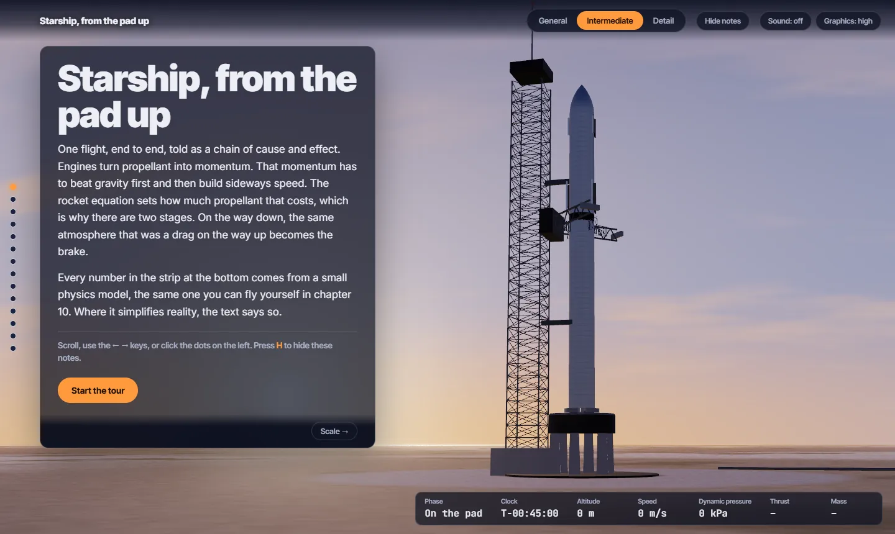
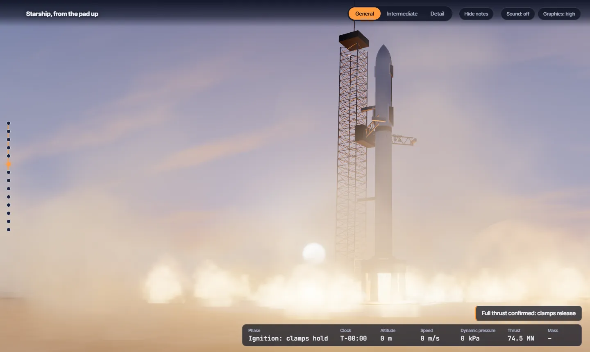
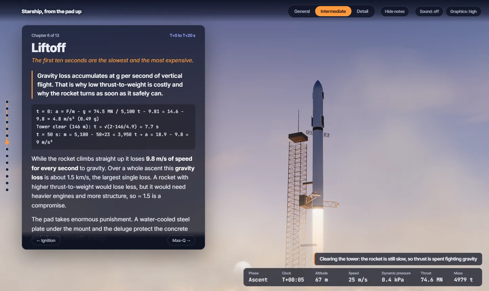
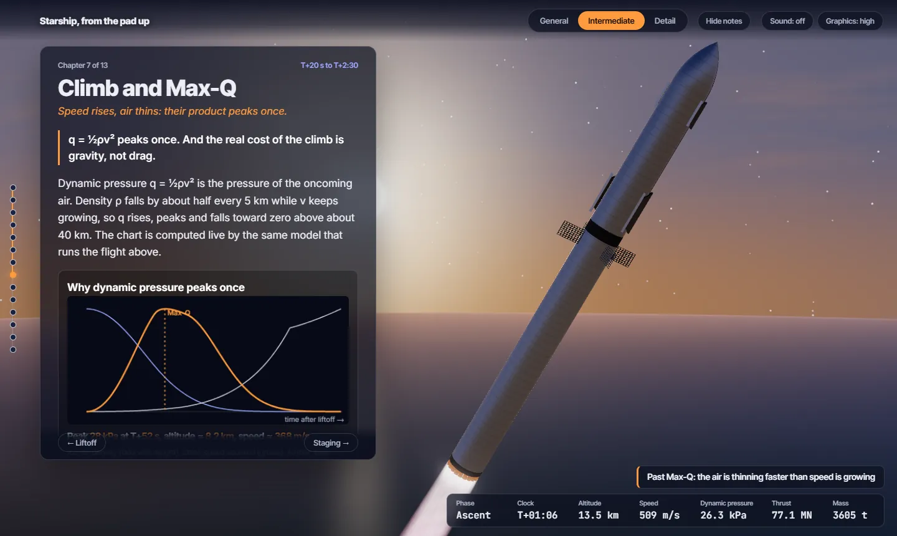
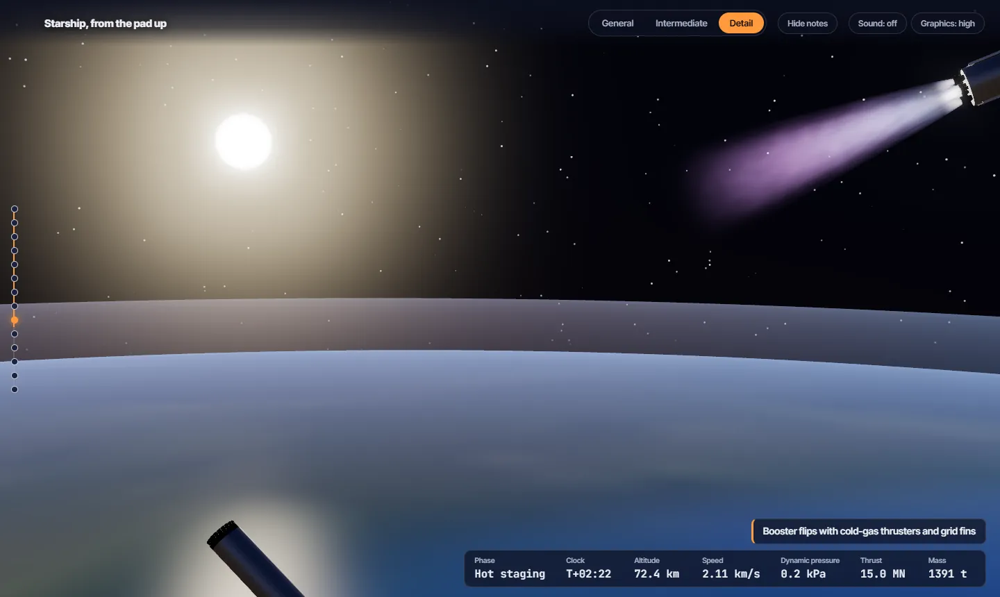
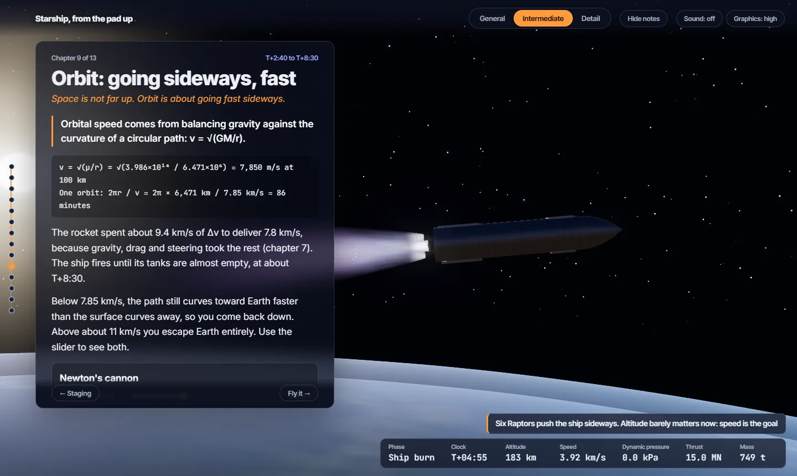
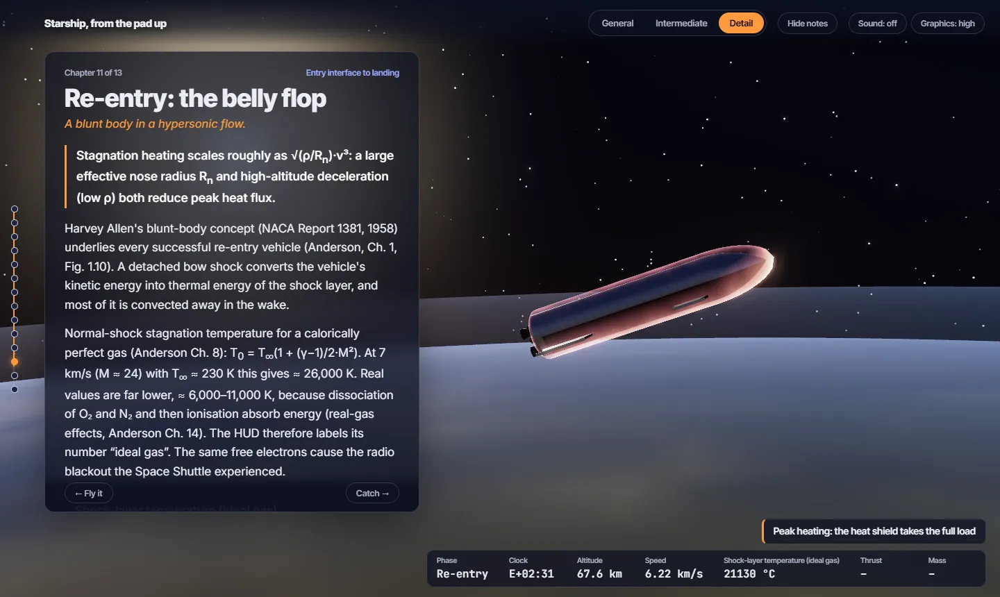
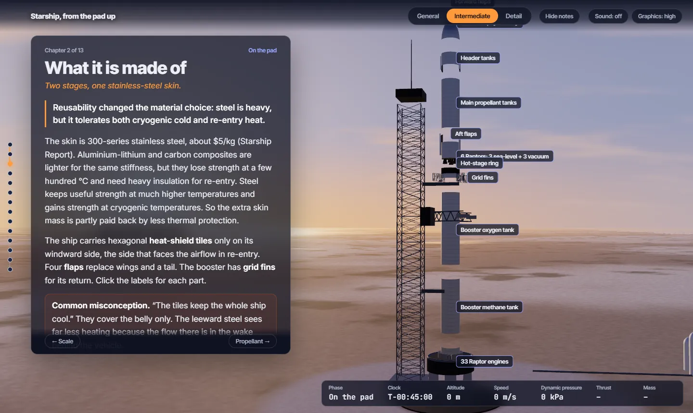
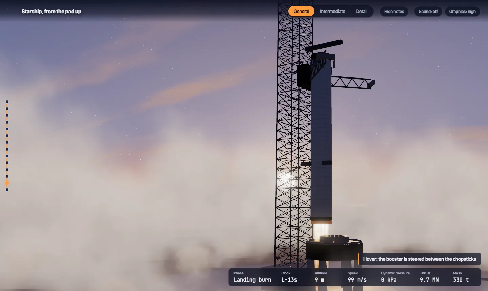
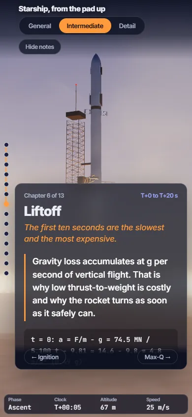

# Starship, from the pad up

**An interactive 3D guide to how SpaceX's Starship flies, built for people who actually want to understand it.**

You stand at Starbase, Texas, at sunset and follow one complete flight: what the vehicle is made of, how the Raptor engine works, liftoff, Max-Q, hot staging, orbit, a belly-flop re-entry and the tower catch. Every chapter can be read at three depths, and every number on screen comes from a small physics model you can fly yourself.

No build step, no backend, about 1.5 MB in total.



## Screenshots

| | |
|---|---|
|  |  |
| **Ignition.** Deluge steam and ground fire roll out from the pad. | **Liftoff.** Worked numbers for thrust-to-weight and gravity loss. |
|  |  |
| **Max-Q.** A live q = ½ρv² chart from the same simulator. | **Hot staging.** The ship's violet vacuum plume over real NASA Earth imagery. |
|  |  |
| **Orbit.** Why "space is not far up, it's fast sideways". | **Re-entry.** Blunt-body physics and the glowing shock layer. |
|  |  |
| **Anatomy.** Exploded view with clickable part labels. | **The catch.** Landing burn and the chopsticks. |

<p align="center"></p>
<p align="center"><em>On phones the notes become a bottom sheet under the scene.</em></p>

## What makes it different

- **One chain of cause and effect, not a list of facts.** Each chapter opens with one key idea, builds it with reasoning and worked numbers, names a common misconception, asks a "check yourself" question, and links to the next chapter.
- **Three depths for every chapter:**
  - *General:* the ideas in plain words.
  - *Intermediate:* the physics, with real numbers worked through.
  - *Detail:* equations, derivations and textbook references (Sutton & Biblarz, Anderson).
- **Numbers that agree with each other.** The telemetry strip, the charts and the "Fly it yourself" simulator all run the same model (`site/js/sim.js`). Thrust, mass flow, c\* and Δv cross-check against textbook values. For example, the Raptor working numbers give c\* ≈ 1,875 m/s, against 1,835 m/s in Sutton's Table 5-5.
- **Interactive widgets in the chapters:** rocket-equation calculator, sea-level vs vacuum nozzle thrust, engine-cycle diagrams, the 33-engine map by flight phase, Max-Q chart, Δv loss budget, one stage vs two, Newton's cannon, re-entry temperature, belly-flop vs tail-first terminal speed, and a full ascent simulator.
- **A realistic scene, built in code:** sunset sky, Gulf of Mexico with sun glitter, deluge steam and ground fire at ignition, Raptor plumes with Mach diamonds that widen into a violet vacuum plume, a plasma shock layer on re-entry, and a real NASA Earth (Blue Marble day, Black Marble city lights, clouds) seen from altitude.
- **Synthesized launch sound:** deep rumble, broadband roar and the crackle of a big rocket, muffled with distance. No audio files are used.

## Chapters

0 Starbase · 1 Scale · 2 Anatomy · 3 Propellant · 4 Raptor · 5 Thrust and the rocket equation · 6 Liftoff · 7 Climb and Max-Q · 8 Hot staging and boostback · 9 Orbit · 10 Fly it yourself · 11 Re-entry · 12 The catch · 13 Sources and glossary

## Run it locally

ES modules do not load from `file://`, so serve the `site/` folder over HTTP:

```bash
cd site
python -m http.server 8123
# open http://localhost:8123
```

On Windows you can also double-click `site/start.bat`.

The `site/` folder is self-contained and can be deployed as-is to any static host (GitHub Pages, Netlify, Cloudflare Pages).

### Controls

| Key / control | Action |
|---|---|
| Scroll, or **←** / **→** | Move through the flight / previous and next chapter |
| **H** or "Hide notes" | Hide the notes to watch the scene |
| General / Intermediate / Detail | Change the depth of every chapter |
| "Ignite", "Play re-entry", "Play booster catch" | Auto-play a phase |
| Sound | Turn on the synthesized launch audio |
| Graphics | Cycle quality (it also lowers itself automatically on slow devices) |

## How it is built

- **three.js r170**, vendored in `site/vendor/` (MIT). Plain ES modules and an import map: no npm, no bundler.
- **Procedural models.** Booster, ship, tower and chopsticks are built from three.js geometry with the published proportions (9 m diameter, 71 m booster, 50 m ship). No 3D model downloads.
- **Deterministic, scroll-scrubbed timeline.** Page position maps to a flight time, and the camera, vehicle state, effects and telemetry are all pure functions of that time, so scrolling backwards works.
- **Two-pass rendering** (an Earth-scale far scene and a metre-scale near scene) so the pad and the planet share one camera without depth-precision problems.
- **GPU effects.** Plumes are instanced shader cones. Steam, fire, deluge and vapour trail are GPU point sprites. Bloom and ACES tone mapping are applied.

```
site/
├── index.html        page shell, fonts, import map
├── start.bat         local server for Windows
├── css/style.css
├── img/              NASA Earth textures (WebP, ~600 KB)
├── js/
│   ├── main.js       renderer, scroll timeline, panels, HUD, audio
│   ├── director.js   keyframes: camera, vehicle state, telemetry per chapter
│   ├── world.js      sky, Earth, ground, water, pad and tower
│   ├── vehicle.js    procedural booster and ship
│   ├── fx.js         plumes, steam, fire, deluge, trail, plasma
│   ├── sim.js        ascent physics model (also drives the widgets)
│   ├── widgets.js    interactive charts and calculators
│   └── content.js    all teaching text, three depths per chapter
└── vendor/           three.js r170
```

## Important notes

- **Numbers are approximate.** Vehicle figures are public estimates, mostly from the V1 era (Starship Report, Jan 2024), and the vehicle has changed since. They are labelled as approximate in the text. Check current SpaceX data for exact values.
- **The simulator is a teaching model:** a planar point mass with an exponential atmosphere, Mach-dependent drag and altitude-dependent thrust. It ignores Earth's rotation, wind, structural dynamics and engine-out. It reproduces trends and orders of magnitude, not actual flight data.
- **Ideal-gas re-entry temperatures** shown in the HUD over-predict, because real air dissociates and ionises at hypersonic speed. The text explains this.
- **One deliberate visual choice:** the pad is at sunset, but above about 30 km the Earth is lit by a higher sun, so its oceans, land and clouds are visible instead of a dark twilight disc.
- **Tank order** inside the booster follows public cutaway diagrams. The ship's tank order is not asserted.
- **Not affiliated with SpaceX.** This is an independent educational project. No SpaceX footage, photos or logos are included.
- **Needs WebGL 2** and works best on a desktop GPU. Respects `prefers-reduced-motion`.

## Sources and credits

| Source | Used for |
|---|---|
| Sutton & Biblarz, *Rocket Propulsion Elements*, 9th ed. (2017) | Thrust equation, rocket equation (Eq. 4-5/4-6), gravity and drag losses (Eq. 4-19/4-20), staging (Eq. 4-36), propellant data (Table 5-5), engine cycles (§6.6), thrust vector control (Ch. 18) |
| Anderson, *Fundamentals of Aerodynamics*, 6th ed. | Blunt-body re-entry (Ch. 1), normal shocks and stagnation temperature (Ch. 8), hypersonic flow (Ch. 14) |
| *The Starship Report*, Payload Research (Jan 2024) | Dimensions, engine counts, thrust, payload, materials, architecture |
| NASA Visible Earth: Blue Marble, Black Marble, cloud and water maps | Earth textures (public domain) |
| [three.js](https://threejs.org) r170 | 3D rendering (MIT) |
| Google Fonts: Inter, Inter Tight, JetBrains Mono | Typography (SIL Open Font License) |

The books and report are cited for reference only. Their content is not included in this repository.
